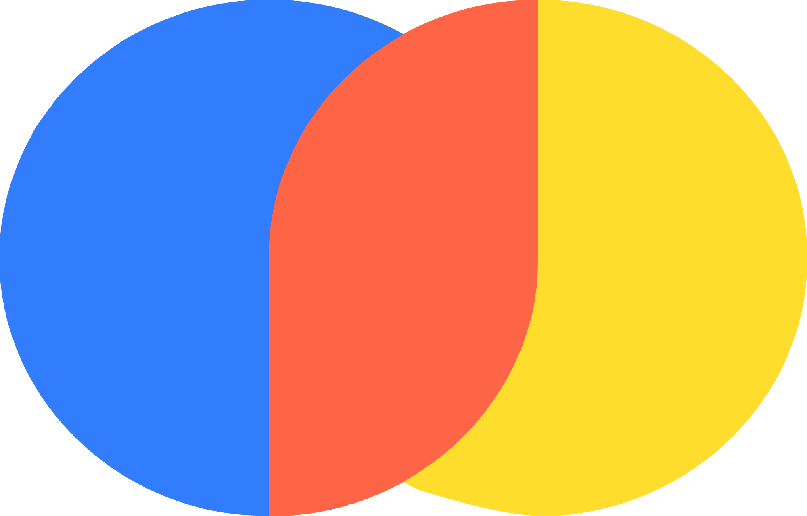
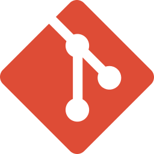
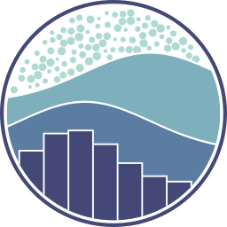

<!-- 

  

 -->

<h1 align="center">Muhammad Mubashir Shafique</h1>
<h3 align="center">AI / ML Engineer | Advanced AI Agents & RAG Systems | MLOps</h3>

  
  
  

---

### About Me

Results-driven **AI/ML Engineer** with hands-on experience building **production-grade agentic RAG architectures**, scalable **end-to-end ML workflows**, and **cross-platform AI applications**.

- 🎓 BS in **Computer Science** — *Sukkur IBA University, Sindh, Pakistan*
- 🚀 Building **end-to-end AI systems** — from multi-agent LLM apps to deployment-ready deep learning pipelines
- 🛠️ Hands-on with **Machine Learning, Deep Learning, Generative AI, AI Agents, RAG, AI Security, and Computer Vision**
- 📱 **Interface Integration** — Leveraging AI tools to build functional Flutter & web frontends
- 📄 **[View My Resume](https://github.com/MubashirShafique/My-Resume/blob/main/Mubashir_Shafique_CV.pdf)**
- 📧 Reach me at: **muhammadmubashirshafique@gmail.com**

---

###  Featured Projects
<table>
<tr>
<td width="50%" valign="top">

### 🧩 [Enterprise Agentic RAG](https://github.com/MubashirShafique/enterprise-agentic-rag)

Enterprise-grade agentic RAG system built on Pydantic AI docs, with LangGraph orchestration and full observability.

`langgraph` `qdrant-vector-database` `nemo-guardrails` `portkey` `langsmith` `fastapi` `ai-red-teaming`

</td>
<td width="50%" valign="top">

### 🌱 [KapasAI](https://github.com/MubashirShafique/KapasAI)

AI-powered cotton farming ecosystem — offline deep learning, multi-agent AI, and RAG for crop disease detection.

`computer-vision` `deep-learning` `multi-agent` `tensorflow-lite` `mobile-app`

</td>
</tr>
<tr>
<td colspan="2">&nbsp;</td>
</tr>
<tr>
<td width="50%" valign="top">

### 📈 [Gold Trend Predictor AI](https://github.com/MubashirShafique/Gold-Trend-Predictor-AI-Project_)

End-to-end gold market trend prediction system using ML, DVC pipelines, FastAPI, and Flutter to forecast bullish/bearish trends.

`xgboost` `mlops` `forecasting` `flutter` `data-science`

</td>
<td width="50%" valign="top">

### 🥇 [Gold Market AI Agent](https://github.com/MubashirShafique/gold-market-ai-agent_)

AI agent combining ML predictions, historical analysis, and real-time web data for BUY/SELL recommendations via LangChain.

`langchain` `chatbot` `financial-analysis` `rest-api`

</td>
</tr>
<tr>
<td colspan="2">&nbsp;</td>
</tr>
<tr>
<td width="50%" valign="top">

### 📬 [Email Assistant Agent](https://github.com/MubashirShafique/email-assistant-agent)

AI-powered Gmail assistant drafting context-aware replies with human-in-the-loop approval before sending.

`openai` `langgraph` `gmail-api` `human-in-the-loop` `streamlit`

</td>
<td width="50%" valign="top">

### 📊 [Mubrix — End-to-End ML](https://github.com/MubashirShafique/mubrix-end-to-end-ml)

Market prediction platform with a complete MLOps pipeline, REST API, Android app, and Streamlit dashboard.

`scikit-learn` `time-series` `android` `data-science`

</td>
</tr>
<tr>
<td colspan="2">&nbsp;</td>
</tr>
<tr>
<td width="50%" valign="top">

### 🎵 [Mijaaz](https://github.com/MubashirShafique/Mijaaz-App-Showcase)

Offline music recommendation app built with Flutter + TensorFlow Lite, using a custom ANN model for mood-based Pakistani & Indian song recommendations.

`artificial-neural-networks` `tensorflow-lite` `flutter` `music-recommendation`

</td>
<td width="50%" valign="top">

### ✉️ [SMS/Email Spam Classifier](https://github.com/MubashirShafique/SMS-Email-Spam-Classifier-End-to-End-Project-)

End-to-end spam detection system across SMS and email using NLP, served via FastAPI/Streamlit and a Flutter client.

`nlp` `machine-learning` `fastapi` `flutter`

</td>
</tr>
</table>

<b>📂 More repositories</b>

 

| Repo | Description | Stack |
|---|---|---|
| [Movie-Recommender-System](https://github.com/MubashirShafique/Movie-Recommender-System) | Content-based movie recommender using cosine similarity | `nlp` `recommendation-system` `streamlit` |
| [My-Learning-Projects](https://github.com/MubashirShafique/My-Learning-Projects) | Collection of ML, DL, GenAI, Agentic AI, RAG & automation projects | `machine-learning` `rag` `n8n` `generative-ai` |
| [Certificates](https://github.com/MubashirShafique/Certificates) | Verified Google Career Certificates (Data Science, GenAI, Advanced Analytics) | `data-science` `statistics` `predictive-modeling` |
| [Web_Engineering](https://github.com/MubashirShafique/Web_Engineering) | Coursework, labs, and semester projects for Web Engineering | `html` |
| [three-mens-morris-desktop](https://github.com/MubashirShafique/three-mens-morris-desktop) | Classic Three Men's Morris game with diagonal-move variant | `java` `swing` |
| [Music-Player-System-Installer](https://github.com/MubashirShafique/Music-Player-System-Installer) | Production-ready Windows installer for a Java desktop app | `java` `inno-setup` `windows-installer` |
| [MusicPlayerSystem-html](https://github.com/MubashirShafique/MusicPlayerSystem-html) | HTML-based music player system | `html` |
| [lab-agile-planning-](https://github.com/MubashirShafique/lab-agile-planning-) | Agile planning lab work | — |

---

##  Tech Stack

<h3 align="center">Programming Languages</h3>

  <kbd>&nbsp; <b>Python</b>&nbsp;</kbd>&nbsp;&nbsp;
  <kbd>&nbsp; <b>Dart</b>&nbsp;</kbd>&nbsp;&nbsp;
  <kbd>&nbsp; <b>JavaScript</b>&nbsp;</kbd>

 

<h3 align="center"> AI Agents, RAG &amp; Generative AI</h3>

  <kbd>&nbsp; <b>LangChain</b>&nbsp;</kbd>&nbsp;&nbsp;
  <kbd>&nbsp; <b>LangGraph</b>&nbsp;</kbd>&nbsp;&nbsp;
  <kbd>&nbsp; <b>n8n</b>&nbsp;</kbd>
  <kbd>&nbsp; <b>FlashRank</b>&nbsp;</kbd>&nbsp;&nbsp;
  <kbd>&nbsp; <b>OpenAI</b>&nbsp;</kbd>&nbsp;&nbsp;
  <kbd>&nbsp; <b>Gemini</b>&nbsp;</kbd>&nbsp;&nbsp;
  <kbd>&nbsp; <b>Groq</b>&nbsp;</kbd>&nbsp;&nbsp;

 

<h3 align="center"> Vector Databases, Guardrails &amp; LLMOps</h3>

  <kbd>&nbsp; <b>Qdrant</b>&nbsp;</kbd>&nbsp;&nbsp;
  <kbd>&nbsp; <b>Portkey</b>&nbsp;</kbd>&nbsp;&nbsp;
  <kbd>&nbsp; <b>LangSmith</b>&nbsp;</kbd>&nbsp;&nbsp;
  <kbd>&nbsp; <b>Pinecone</b>&nbsp;</kbd>&nbsp;&nbsp;
  <kbd>&nbsp; <b>Chroma</b>&nbsp;</kbd>

 

<h3 align="center"> Machine Learning &amp; Deep Learning</h3>

  <kbd>&nbsp; <b>TensorFlow Lite</b>&nbsp;</kbd>&nbsp;&nbsp;
  <kbd>&nbsp; <b>XGBoost</b>&nbsp;</kbd>&nbsp;&nbsp;
  <kbd>&nbsp; <b>scikit-learn</b>&nbsp;</kbd>&nbsp;&nbsp;
  <kbd>&nbsp; <b>Keras</b>&nbsp;</kbd>

 

<h3 align="center"> Data Science &amp; MLOps</h3>

  <kbd>&nbsp; <b>Pandas</b>&nbsp;</kbd>&nbsp;&nbsp;
  <kbd>&nbsp; <b>NumPy</b>&nbsp;</kbd>&nbsp;&nbsp;
  <kbd>&nbsp; <b>DVC</b>&nbsp;</kbd>&nbsp;&nbsp;
  <kbd>&nbsp; <b>MLflow</b>&nbsp;</kbd>&nbsp;&nbsp;
  <kbd>&nbsp; <b>Git</b>&nbsp;</kbd>&nbsp;&nbsp;
  <kbd>&nbsp; <b>Power BI</b>&nbsp;</kbd>&nbsp;&nbsp;
  <kbd>&nbsp; <b>Matplotlib</b>&nbsp;</kbd>&nbsp;&nbsp;
  <kbd>&nbsp; <b>Seaborn</b>&nbsp;</kbd>

 

<h3 align="center"> Backend, APIs &amp; Mobile</h3>

  <kbd>&nbsp; <b>Streamlit</b>&nbsp;</kbd>&nbsp;&nbsp;
  <kbd>&nbsp; <b>FastAPI</b>&nbsp;</kbd>&nbsp;&nbsp;
  <kbd>&nbsp; <b>Flutter</b>&nbsp;</kbd>

---

### GitHub Activity

<table align="center" width="100%">
  <!-- Top Center Card -->
  <tr>
    <td align="center" colspan="2">
      
    </td>
  </tr>
  <!-- Bottom Two Cards -->
  <tr>
    <td align="center" width="50%">
      
    </td>
    <td align="center" width="50%">
      
    </td>
  </tr>
</table>

---

### 🎓 Certifications

- **Google Advanced Data Analytics Professional Certificate** — [Verify Credential](https://coursera.org/share/60092242ab1325c834f1da0427630ec4)
- **Google IT Automation with Python Professional Certificate** — [Verify Credential](https://www.coursera.org/account/accomplishments/specialization/IXU6X5QP96H9)

---

